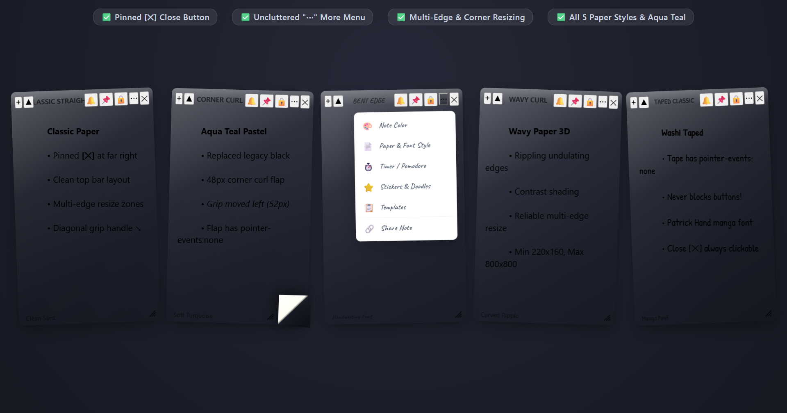
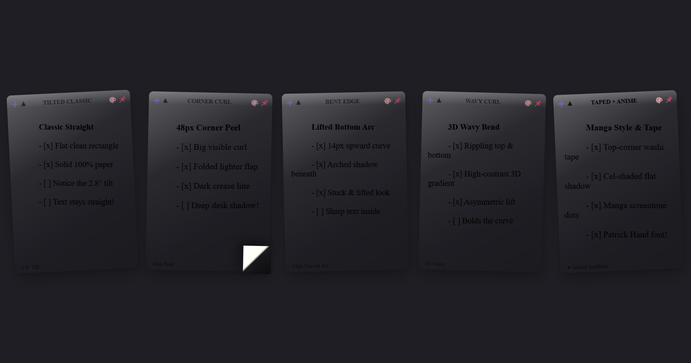

# 📝 StickyPad

> A tactile, distraction-free desktop sticky note app designed to live naturally on your screen.



---

## 💡 Why I Made StickyPad

Most note-taking apps today have grown too complex: they require accounts, sync over remote clouds, and bury quick thoughts behind nested folders and slow web editors. I wanted sticky notes that feel physical, nimble, and tactile—notes that sit right on the desktop, never steal focus, make satisfying paper rustle sounds, and give your thoughts a place to breathe without feeling like work.

---

## ✨ Features

- **Realistic Physical Paper Styles**: Choose between *Straight*, *Corner Curl* with paper hover peeling, *Bent Edge*, *Wavy Lift*, or *Taped* with translucent washi tape.
- **Fold & Unfold (Collapse)**: Click the fold arrow to instantly collapse any note into a clean, compact title bar strip when desk space is needed.
- **Procedural Sound Effects**: Gentle paper rustles, crisp pencil scratches, tape peels, and bell chimes synthesized in pure Web Audio (no external audio files needed).
- **Reminders & Alerts**: Set quick alerts (in 10 min, 1 hour, tonight, or custom date/time). Active reminders ring desktop notifications and bring the note to focus even when collapsed.
- **Trash & Safe Undo**: Deleting a note places it in Trash for 30 days before purging. Quickly undo accidental tosses with `Ctrl+Z` or browse the Trash bin.
- **All Notes Search**: Press `Ctrl+Shift+F` to search notes live by text, preview colors and edit times, and jump directly to any note.
- **Pin & Lock Modes**:
  - **Pin (`Ctrl+P`)**: Keep essential notes always on top.
  - **Lock (`Ctrl+L`)**: Protect notes from accidental edits or dragging while letting clicks pass through to the windows underneath.
- **Color Themes & Typography**: 8 gentle pastel tones and 3 swappable fonts (Clean Sans, Caveat handwriting, and Patrick Hand manga font) that can be mixed within the same note.
- **Checklists & Doodles**: Native interactive `- [ ]` checkboxes and a built-in doodle pen mode for quick sketches and diagrams.
- **Image Sharing**: Export or copy any note as a crisp, 2x resolution PNG with realistic paper shadows intact.

---

## 📸 Screenshots

| Physical Paper Styles | Clean Desktop Organization |
| :---: | :---: |
|  |  |

---

## ⌨️ Keyboard Shortcuts

| Action | Shortcut | Description |
| :--- | :--- | :--- |
| **New Note** | `Ctrl+N` / `Ctrl+Shift+N` | Create a new sticky note instantly |
| **Delete / Close Note** | `Ctrl+W` | Send current note to Trash |
| **Lock Note** | `Ctrl+L` | Toggle lock mode (click-through protection) |
| **Search Notes** | `Ctrl+Shift+F` | Open All Notes & instant search |
| **Pin Note** | `Ctrl+P` | Toggle always-on-top |
| **Minimize / Collapse** | `Ctrl+M` | Collapse or expand the note card |
| **Undo Delete** | `Ctrl+Z` | Restore last tossed note from Trash |
| **Alt-Drag** | `Alt + Drag` | Move note from anywhere on the paper |
| **Checklist Item** | `- [ ] ` + `Space` | Convert current line into an interactive checkbox |

---

## 🔒 100% Local Privacy Guarantee

Your thoughts belong to you. StickyPad is built with strict privacy principles:
- **No Cloud Required**: All notes, reminders, and preferences remain stored solely on your computer.
- **Zero Telemetry & Tracking**: No analytics, telemetry pings, background beacons, or user identification.
- **Full Offline Operation**: Works without an internet connection.
- **Atomic File Saving**: Notes are written to a temporary staging file before atomic renaming, protecting your data against unexpected power loss.

---

## 🚀 Quick Start (Development)

### Prerequisites
- [Node.js](https://nodejs.org/) (version 18 or higher recommended)
- `npm` (bundled with Node.js)

### Installation
```bash
# 1. Clone the repository
git clone https://github.com/Karnozetrex/stickypad.git
cd stickypad

# 2. Install dependencies
npm install

# 3. Launch StickyPad
npm start
```

---

## 📦 Building Installers

StickyPad uses `electron-builder` to package native standalone installers:

### Windows (`.exe` / portable)
```bash
npm run dist:win
```

### macOS (`.dmg` / `.zip`)
```bash
npm run dist:mac
```

### Linux (`.AppImage` / `.deb`)
```bash
npm run dist:linux
```

---

## 🤝 Contributing

Contributions, bug reports, and feedback are welcome! Please read [CONTRIBUTING.md](CONTRIBUTING.md) for local setup instructions and guidelines.

---

## 📄 License & Third-Party Notices

- StickyPad is released under the [MIT License](LICENSE).
- For bundled open-source assets and typography font licenses, refer to [THIRD_PARTY_NOTICES.md](THIRD_PARTY_NOTICES.md).
